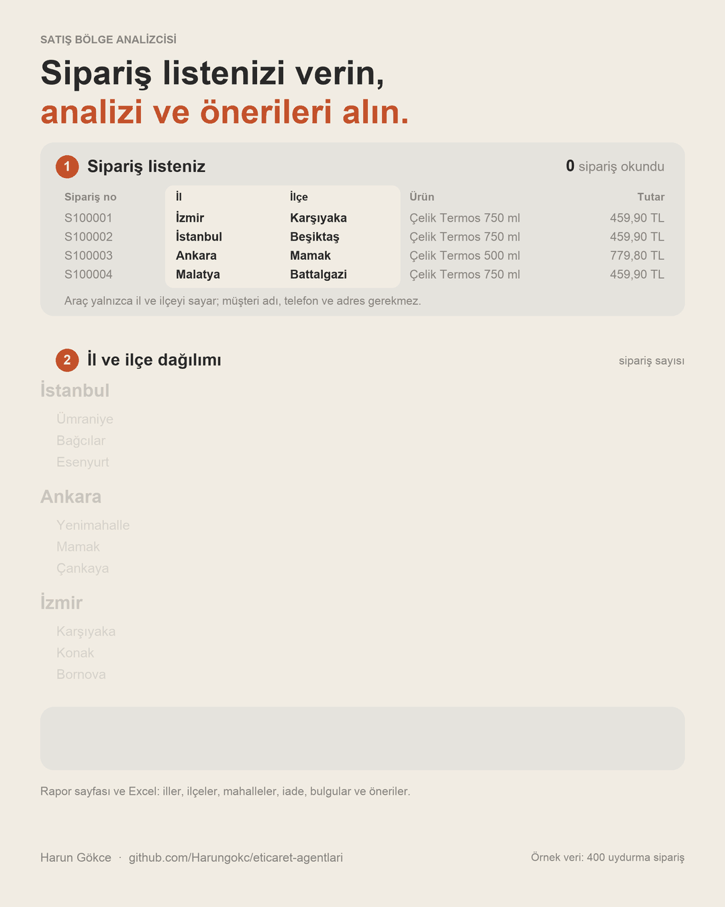

# Satış Bölge Analizcisi

Satışlarınız nereye gidiyor, bununla ne yapmalısınız? Bu araç sipariş listenizdeki il, ilçe ve mahalle
bilgisini sayar, sayılardan bulgu ve öneri çıkarır ve hepsini bir **rapor** olarak verir:

<div align="center">
  <video src="https://github.com/user-attachments/assets/5eb9d5ed-25f8-4e15-b355-6ad600e6da6f" controls></video>
</div>



| Soru | Rapor ne gösterir |
|---|---|
| **En çok nereye satıyorum?** | Bölge, il, ilçe ve mahalle bazında sipariş sayısı, pay, ciro ve ortalama sepet |
| **İlin içinde nereye?** | Her büyük il için ilçeleri, her ilçenin altında öne çıkan mahalleleri |
| **Satışlarım ne kadar yoğunlaşmış?** | İlk 3 ve ilk 10 ilin payı; sipariş gelmeyen iller |
| **Nerede sorun var?** | İl ve ilçe bazında iade oranı; ortalamanın belirgin üstünde olan yerler işaretlenir |
| **Ne yapmalıyım?** | Sayılara dayanan bulgular ve öneriler: reklam, ilçe ve mahalle hedefleme, kargo, sepet, iade, boşluklar, ürün |

Sonucu **rapor sayfası** (tarayıcıda açılır, yazdırılır) ve **Excel dosyası** olarak verir. Ücretsiz,
açık kaynak (MIT).

## Önce: müşteri bilgilerini çıkarın

Sipariş dökümleri müşteri adı, telefon ve açık adres içerir. **Bu analiz için bunların hiçbiri
gerekmez.** Dosyayı Claude ya da ChatGPT'ye yüklemeden önce Excel'de bu sütunları silin; yalnızca
şunlar kalsın: il, ilçe, mahalle, tutar, ürün, sipariş no, durum.

Müşterilerinizin kişisel verilerini bir yapay zekâ hizmetine yüklemek, KVKK kapsamında sizin
sorumluluğunuzdadır. Araç bu sütunları dosyada olsa bile okumaz ve çıktıya yazmaz, ama dosyayı
yüklediğiniz anda o hizmete göndermiş olursunuz; bu yüzden silme işini yüklemeden önce yapın.

Mahalle tek başına bir kişiyi göstermez, ama çok az siparişli bir mahalle gösterebilir. Bu yüzden araç
3 siparişten azı olan mahalleleri tek tek listelemez.

## Claude ya da ChatGPT sohbetinde kullanın

Tek tek yüklemek yerine serideki bütün araçları içeren [tek paketi](../README.md) kullanabilirsiniz.
Yalnızca bu aracı isterseniz: [satis-bolge-analizcisi.zip](https://github.com/Harungokc/eticaret-agentlari/releases/latest/download/satis-bolge-analizcisi.zip)

Sipariş dökümünüzü (kişisel sütunları sildikten sonra) mesaj kutusundaki **+** düğmesiyle sohbete
ekleyin ve yazın:

> Bu sipariş listesinden satış bölge raporumu hazırla: hangi il, ilçe ve mahallelere satıyorum,
> nerelere hiç satamıyorum, iade nerede yüksek, ne yapmalıyım?

Dosya eklemeden sorarsanız asistan sizden sipariş listesini ister; araç listesiz çalışmaz.

## Örnek sonuç

Uydurma 400 siparişle (`ornek/ornek_siparisler.csv`), çıktının bir bölümü:

```
SATIŞ BÖLGE ANALİZİ — 393 sipariş, 26 il, ciro 177.430,70 TL
  Siparişlerde ilk 3 ilin payı %57,8, ilk 10 ilin payı %81,7.

İSTANBUL İÇİNDE İLÇELER VE MAHALLELER
  Ümraniye                 33 sipariş  ildeki payı  %28,0   mahalleler: Atakent 20, Çakmak 6, Esenevler 4, İstiklal 3
  Bağcılar                 20 sipariş  ildeki payı  %16,9   mahalleler: Kirazlı 9, Güneşli 7, Mahmutbey 4
  Esenyurt                 19 sipariş  ildeki payı  %16,1   mahalleler: Fatih 12, Cumhuriyet 5

BULGULAR VE ÖNERİLER (10)
  1. [Reklam] Siparişlerde ilk üç ilin payı %57,8
     Bulgu: 393 siparişte ilk üç il İstanbul, Ankara ve İzmir; birlikte payları %57,8, ilk 10 ilin payı %81,7.
     Öneri: Reklam bütçesinin ana bölümünü bu üç ile ayırın; Türkiye geneli hedefleme bütçeyi sipariş gelmeyen
            illere dağıtır. ...
  7. [İade] İade oranı yüksek: İstanbul / Ümraniye
     Bulgu: İstanbul / Ümraniye: 33 siparişte 3 iade (%9,1). Genel iade oranı %4,8.
     Öneri: Buradaki iadelerin nedenine bakın: teslimat süresi, hasarlı kargo ya da ürün açıklamasıyla
            uyuşmazlık. ...
```

## Bulgular ve öneriler nasıl üretilir

Öneriler yapay zekâ tahmini değildir; listedeki sayılara uygulanan sabit kurallardan çıkar. Bir kuralın
eşiği aşılmazsa o öneri yazılmaz.

| Konu | Ne zaman yazılır |
|---|---|
| Reklam | İlk 3 ilin sipariş payı %50 ve üstündeyse |
| İlçe | İlk 3 ilden birinde en az 30 sipariş varsa ve ilk 3 ilçesi o ilin siparişlerinin %40'ından fazlasıysa |
| Mahalle | En az 5 sipariş gelen mahalle varsa (ilk 5 mahalle yazılır) |
| Kargo | Bir bölgenin sipariş payı %35 ve üstündeyse |
| Sepet | En az 20 siparişli bir ilde ortalama sepet genelin %8 üstünde ya da %15 altındaysa |
| İade | En az 20 siparişli bir il ya da ilçede en az 3 iade varsa ve oran genelin 1,5 katını ve 3 puan fazlasını aşıyorsa; ayrıca en az 40 siparişte hiç iade yoksa |
| Boşluk | Liste en az 100 siparişse ve nüfusu en kalabalık 10 ilden birinin payı %1'in altındaysa |
| Ürün | En az 15 siparişli bir ilde en çok satan ürün, genelde en çok satandan farklıysa |

"Nüfusu en kalabalık 10 il" TÜİK'in 2023 adrese dayalı nüfus sıralamasıdır (İstanbul, Ankara, İzmir,
Bursa, Antalya, Konya, Adana, Şanlıurfa, Gaziantep, Kocaeli). Araç nüfus sayısı içermez.

## Kendi bilgisayarınızda çalıştırmak

Python 3.10 veya üstü yeterlidir; ek paket gerekmez. Bu yolda dosyanız bilgisayarınızdan çıkmaz.

```bash
python3 agent.py analiz ornek/ornek_siparisler.csv --rapor rapor.html --excel sonuc.xlsx
python3 -m unittest          # testler
```

Dosya, ilk satırında başlıklar olan bir CSV'dir ([şablon](ornek/sablon.csv)). Zorunlu sütun yalnızca
`il`dir; `ilçe`, `mahalle`, `tutar`, `ürün`, `sipariş no` ve `durum` isteğe bağlıdır. Yazım önemli
değildir (İSTANBUL, istanbul, Urfa, K.Maraş; "Atakent Mah.", "ATAKENT MAHALLESİ" tanınır).

## Bilmeniz gereken sınırlar

- Sonuçlar verdiğiniz listeyle sınırlıdır; tek bir ayın siparişleri mevsim etkisi taşıyabilir.
- Bir ilin payının yüksek olması nüfusla da ilgilidir; araç nüfusa oranlamaz.
- İade oranı ve ortalama sepet az siparişli yerlerde yanıltıcıdır; araç bunları en az 20 siparişli
  yerlerde yorumlar.
- Öneriler denenecek adımlardır; araç reklam harcamanızı, kârınızı ve mevsimi bilmez.
- Araç adres çözümlemez. Dökümünüzde il, ilçe ya da mahalle ayrı sütun değilse asistan bunları adres
  metninden ayırmaya çalışır; ayıramadığı satırlar ilgili düzeyde sayılmaz.
- Araç gerçek bir pazaryeri dökümüyle henüz denenmedi; örnek dosya uydurmadır.
- Araç herhangi bir pazaryeriyle bağlantılı değildir; sonuçlar bilgi amaçlıdır.

**Geliştiren:** Harun Gökce — harungokce70@gmail.com · 0506 155 46 42
