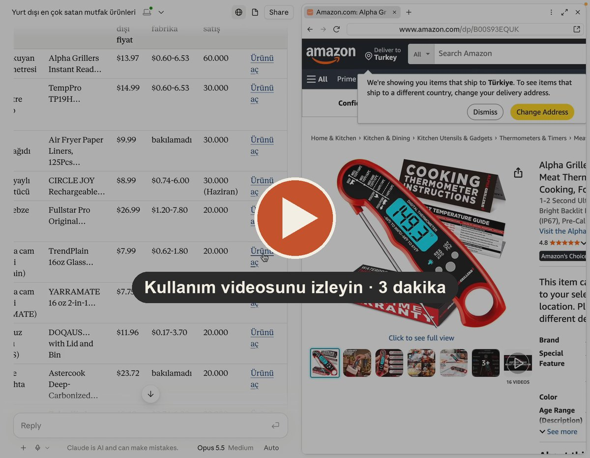
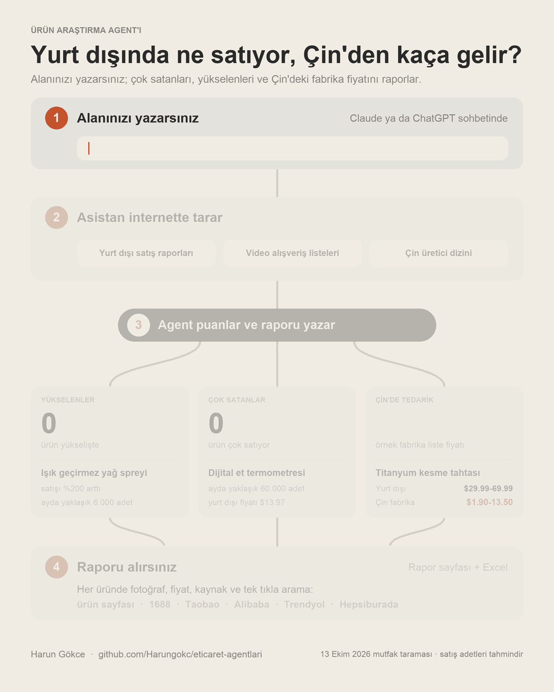

# Ürün Araştırma Agent'ı

Alanınızda yurt dışında şu an ne çok satıyor, ne yeni yükseliyor? Bu araç, Claude ya da ChatGPT'nin
internette yaptığı taramayı kaynaklı ve tarihli bir **rapora** çevirir:

[](https://github.com/Harungokc/eticaret-agentlari/blob/main/kilavuz/gorseller/05-urun-arastirma-video.mp4)

**[▶ Kullanım videosunu izleyin](https://github.com/Harungokc/eticaret-agentlari/blob/main/kilavuz/gorseller/05-urun-arastirma-video.mp4)** (3 dakika, sessiz): aracın
Claude'a yüklenmesi, tek cümlelik istek, raporun ve Excel'in açılması, ürün ve Çin'de tedarik bağlantılarına tıklanması. Bekleme
kısmı hızlandırılmıştır; gerçek tarama 7 dakikadan uzun sürdü.



| Soru | Rapor ne gösterir |
|---|---|
| **Ne yeni yükseliyor?** | Satışının büyük bölümü son 30 güne ait olan ürünler; ayrıca güncel yazılarda geçenlerin izleme listesi |
| **Ne çok satıyor?** | Satış sırası, satış adedi ve yorum sayısına göre en güçlü ürünler |
| **Ürün neye benziyor?** | Her ürünün listedeki adı, fotoğrafı, fiyatı ve tek tıkla açılan bağlantılar: ürün sayfası, görseller, Trendyol ve Hepsiburada araması |
| **Çin'den kaça gelir?** | Ürün türü başına Çin'deki üretici dizininde görülen fabrika liste fiyatı, en az sipariş adedi ve tedarikçi illeri; her ürün için 1688, Taobao, Alibaba, AliExpress, Made-in-China ve Temu'da tek tıkla arama |
| **Bu rakam nereden geldi?** | Her ürünün altında kaynak bağlantısı ve tarihi; görülemeyen rakam açıkça yazılır |
| **Türkiye'de satılır mı, kâr eder mi?** | Siz pazaryerinizdeki ilan sayısını ve maliyeti girince: rekabet, ürün başına kâr, karar |
| **Riski var mı?** | İthalatı yasak, izne bağlı ya da belge isteyen ürünler için uyarı |

Sonucu **rapor sayfası** (tarayıcıda açılır, yazdırılır) ve **Excel dosyası** olarak verir. Ücretsiz,
açık kaynak (MIT).

## Kim ne yapar

- **Asistan (Claude ya da ChatGPT) tarar.** İnternette arama yapıp ürünleri, gördüğü rakamları ve
  bağlantıları toplar. Bunun için sohbette internet araması açık olmalıdır.
- **Çin tarafı her taramanın parçasıdır.** Asistan her ürün türünün Çince adını yazar ve üretici dizininden
  fabrika liste fiyatını toplar. 1688, Taobao ve benzeri Çin siteleri asistana açılmaz; rapor bunlar için
  ürüne özel arama bağlantısı verir, siz tıklayıp bakarsınız.
- **Araç hesaplar ve raporu yazar.** Asistanın topladığı listeyi puanlar. Araç internete bağlanmaz,
  rakam üretmez; listede olmayan bir rakamı tahmin etmez. Rapordaki arama bağlantılarını yalnızca kurar;
  tıklayınca sizin tarayıcınızda açılır.
- **Siz Türkiye'ye bakarsınız.** Türkiye'deki pazaryerleri asistana açılmaz. Rapor, beğendiğiniz ürünler
  için kendi pazaryerinizde neye bakacağınızı anlatır (ürün başına yaklaşık bir dakika).

## Claude ya da ChatGPT sohbetinde kullanın

Serideki bütün araçları içeren [tek paketi](../README.md) kullanabilirsiniz. Yalnızca bu aracı isterseniz:
[urun-arastirma-agenti.zip](https://github.com/Harungokc/eticaret-agentlari/releases/latest/download/urun-arastirma-agenti.zip)

ZIP dosyasını sohbete yükleyin (Claude'da beceri olarak da eklenebilir), internet aramasını açın ve yazın:

> Mutfak ürünleri satıyorum. Yurt dışında şu an çok satan ve yeni yükselen mutfak ürünlerini tara,
> raporunu hazırla.

Raporu aldıktan sonra beğendiğiniz ürünler için:

> Titanyum kesme tahtası: Trendyol'da ilk sayfada aynı üründen 0 ilan var. Bana maliyeti 260 TL,
> 649 TL'ye satmayı düşünüyorum. Komisyon %18, kargo 55 TL. Kârını ve kararını ekle.

## Örnek sonuç

Uydurma 12 ürünle (`ornek/ornek_adaylar.csv`):

```
ÜRÜN ARAŞTIRMA RAPORU — Mutfak ürünleri — 12 Ekim 2026 — 12 ürün, 6 kaynak site

YÜKSELENLER — 3 ürün (yükselişi satış rakamıyla ölçülenler)
   #  Ürün                                         Yükseliş Kanıt   Satış gücü  Sınıf
   1  Buzlu içecek (slush) bardağı                       89 güçlü           44  Yeni yükselen
   2  Titanyum kesme tahtası                             75 güçlü           69  Çok satan ve yükselen
   3  Hava geçirmez saklama kabı seti (40 parça)         68 orta            48  Yeni yükselen

ÇOK SATANLAR — 6 ürün (1 tanesi yükselenler listesinde de var)
   #  Ürün                                         Satış gücü   Sıra  30 gün satış  Toplam satış     Yorum Yükseliş
   1  Yalıtımlı pipetli bardak (1,2 litre)                100      1             -             -   138.000        -
   2  Sebze doğrayıcı seti                                 81     12        30.000             -   126.000        7
   3  Cam yağ püskürtme şişesi                             80      9        40.000             -    32.800       24
   4  Dijital mutfak terazisi                              76      4         5.743       249.080   177.000        0

YAZILARDA GEÇENLER — 3 ürün (izleme listesi: satış rakamı görülemedi, yükselişi doğrulanmadı)
   Elde taşınır vakumlu poşet kapatıcı — 2 sitede güncel yazı, en yenisi 20 Eylül 2026

ÇİN'DE TEDARİK — 12 ürünün 3 tanesinde fabrika liste fiyatı, 5 tanesinde Çince ad var
  Ürün türü                          Çince adı    Yurt dışı        Çin fabrika (liste)  En az sipariş  Ürün
  Buzlu içecek bardağı               冰沙杯          $14.99           $1.35-1.80           20             1
  Hava geçirmez saklama kabı seti    密封保鲜盒套装      $19.98           $6.20-7.40           100            1
  Titanyum kesme tahtası             钛砧板          $29.90           $7.90-9.90           500            1
```

Dijital mutfak terazisi çok satıyor ama yükseliş puanı 0: bugüne kadarki satışının yalnızca %2,3'ü son
30 güne ait, yani yerleşik bir ürün. Saklama kabı setinde bu oran %37,4: yeni ve hızlı.

## Puanlar nasıl hesaplanır

**Satış gücü (0–100).** 50 ve üstü "çok satan" sayılır.

| İşaret | Ağırlık | Ölçek |
|---|---|---|
| Kategorisindeki satış sırası | 40 | 1. sıra tam puan, 10.000. sıra 0 |
| 30 güne oranlanmış satış adedi | 35 | 500 adet 0, 100.000 adet tam puan |
| Yorum sayısı | 25 | 100 yorum 0, 100.000 yorum tam puan |
| Bugüne kadarki toplam satış adedi | 25 | 1.000 adet 0, 1.000.000 adet tam puan |

**Yükseliş (0–100).** 60 ve üstü "yükselen" sayılır.

| İşaret | Ağırlık | Ölçek |
|---|---|---|
| Satışın ne kadarının son 30 güne ait olduğu | 40 | %5 ve altı 0, %40 ve üstü tam puan |
| Satışın bir önceki aya göre artışı | 30 | %10 ve altı 0, %60 ve üstü tam puan |
| Son 120 günde ürünü anlatan yazıların kaç ayrı sitede çıktığı | 35 | 1 site 12, 2 site 24, 3 ve üstü tam puan |
| Arama ilgisinin yönü | 25 | yükseliyor 25, düz 8, düşüyor 0 |
| "Yeni ürün": 30 günlük satışın yorum sayısına oranı | 20 | zayıf işaret; tek başına yükselen saydırmaz |

Küçük rakamlar ölçülmez: toplam satışı 10.000 adedin ya da aylık satışı 2.000 adedin altındaki üründe
yükseliş hesaplanmaz (bir haftalık ilan her zaman "yeni" görünür). 120 günden eski satış rakamı yükseliş
sayılmaz.

**Görülemeyen işaret puanı düşürmez.** Puan, bilinen işaretler üzerinden hesaplanır; kaç işaretin
bilindiği "kanıt" düzeyi olarak yanında yazar (güçlü, orta, zayıf). Bir ürünün "yükselen" sayılması
için satış rakamı şarttır; yalnızca yazılarda geçen ürün izleme listesinde kalır.

| Sınıf | Anlamı |
|---|---|
| Çok satan ve yükselen | İki puan da eşiğin üstünde |
| Yeni yükselen | Yükseliyor; satış gücü henüz düşük ya da ölçülemedi |
| Yükseliş adayı | Güncel yazılarda geçiyor ya da arama ilgisi artıyor; satış rakamı görülemedi (izleme listesi) |
| Çok satan | Çok satıyor; yeni bir yükseliş yok ya da bilinmiyor |
| Öne çıkmadı | Rakamları görüldü, iki eşiğin de altında |
| Kanıt yetersiz | Kaynak bağlantısı yok ya da hiçbir rakam görülemedi |

## Çin'de tedarik

Rapor sayfasında ve Excel'de ayrı bir bölümdür; ürün türü başına bir satır:

| Sütun | Anlamı |
|---|---|
| Çince adı | 1688 ve Taobao'da aranacak terim |
| Yurt dışı fiyatı | O türdeki ürünlerin kaynak sayfalarda görülen satış fiyatı aralığı |
| Çin'de fabrika fiyatı (liste) | Üretici dizinindeki benzer ürünlerin fiyat aralığı; çoğunlukla FOB, dolar |
| En az sipariş | Tedarikçilerin istediği en düşük adet aralığı |
| Tedarikçi | Kaç tedarikçiye bakıldığı ve illeri |

Fabrika fiyatı **liste fiyatıdır**: nakliye, gümrük, vergi dahil değildir; sipariş adedine ve pazarlığa
göre değişir. Araç bu fiyattan kâr hesaplamaz; kâr için toplam maliyeti siz girersiniz. Tedarikçilerin
çoğu üretici değil ticaret şirketidir; 1688'deki iç pazar fiyatı genellikle daha düşüktür.

## Türkiye, kâr ve karar

Listeye Türkiye'deki ilan sayısı ve maliyet girildiğinde eklenir.

- **Rekabet:** kendi pazaryerinizde ürünü aratınca ilk sayfada gerçekten aynı ürün olan ilan sayısı.
  0 bulunamadı, 1–5 az satıcı, 6–20 orta, 21 ve üstü kalabalık.
- **Kâr:** satış fiyatı − toplam maliyet − komisyon − kargo. KDV, gelir vergisi, iade ve reklam gideri
  dahil değildir. Toplam maliyeti (alış, taşıma, gümrük, vergi) siz girersiniz; araç gümrük hesaplamaz.
- **Karar:** *öncelikli* için ürün çok satan ya da yükselen olmalı, sizin baktığınız pazaryerinde satan
  olmamalı ya da az olmalı, kâr marjı en az %20 olmalı, ürün yasaklı ya da izne bağlı olmamalıdır.
  Zarar eden ya da ithalatı yasak ürün *elenir*.

## Bilgisayarınızda çalıştırın

Python 3.10 ya da üstü yeterlidir; ek paket gerekmez.

```bash
python3 agent.py tara ornek/ornek_adaylar.csv --alan "Mutfak ürünleri" --tarih 2026-10-12 \
  --rapor rapor.html --excel rapor.xlsx
```

Kendi listenizi `ornek/sablon.csv` dosyasını doldurarak hazırlayabilirsiniz. Yalnızca `ad` sütunu
zorunludur; boş hücre "görülemedi" sayılır. Sütunların açıklaması [SKILL.md](SKILL.md) dosyasındadır.

## Sınırlar

- Rapor, taramanın yapıldığı gün asistanın açabildiği sayfalarla sınırlıdır. Büyük pazaryerlerinin ve
  sosyal medya platformlarının kendi sayfaları asistana çoğu zaman açılmaz; rakamlar bu verileri
  yayımlayan üçüncü taraf sitelerden gelir. Açılamayan kaynaklar raporda yazar.
- Çin'in iç pazar siteleri (1688, Taobao, JD, Pinduoduo, Douyin) okunamaz; "Çin'de ne çok satıyor" sorusuna
  rapor cevap vermez. Çin tarafında verilen şey tedarik fiyatı ve arama bağlantılarıdır.
- Rakamlar çoğunlukla ABD ve İngiltere pazarına aittir ve tek bir haftanın ya da ayın görüntüsüdür.
- Yükselenler çoğu zaman tek bir haftalık satış listesine dayanır; kanıt düzeyi raporda yazar.
- Listelerdeki ürünlerin bir kısmı markalı ya da tek satıcıya özgüdür; aynısını getirmek mümkün
  olmayabilir.
- Aynı soru farklı günlerde farklı ürünler getirebilir.
- Yurt dışında satması Türkiye'de satacağını göstermez; rapor bir satış garantisi değildir.
- Risk uyarıları ürün adındaki kelimelere göre üretilen genel bilgidir. Uyarı çıkmaması ürünün serbest
  olduğunu göstermez; ithalat ve belge koşullarını gümrük müşavirinize sorun.
- Örnek dosyadaki ürünler ve rakamlar uydurmadır.

Geliştiren: Harun Gökce — harungokce70@gmail.com
