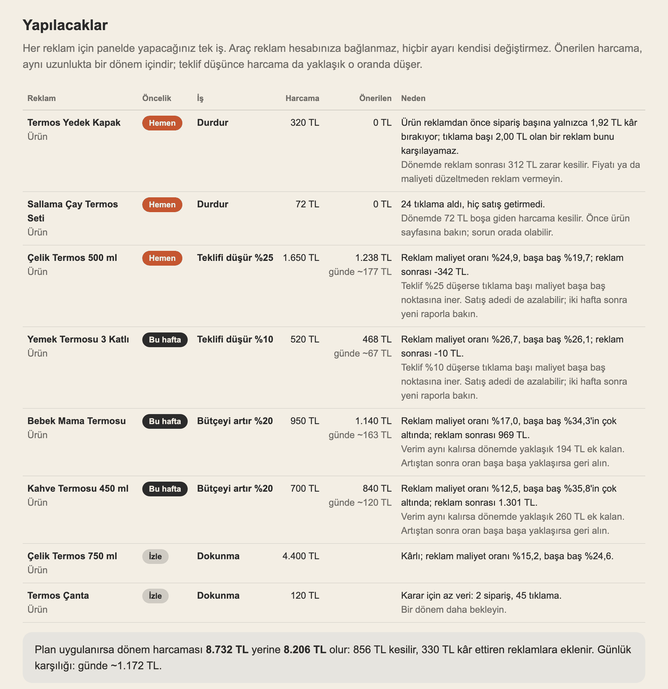
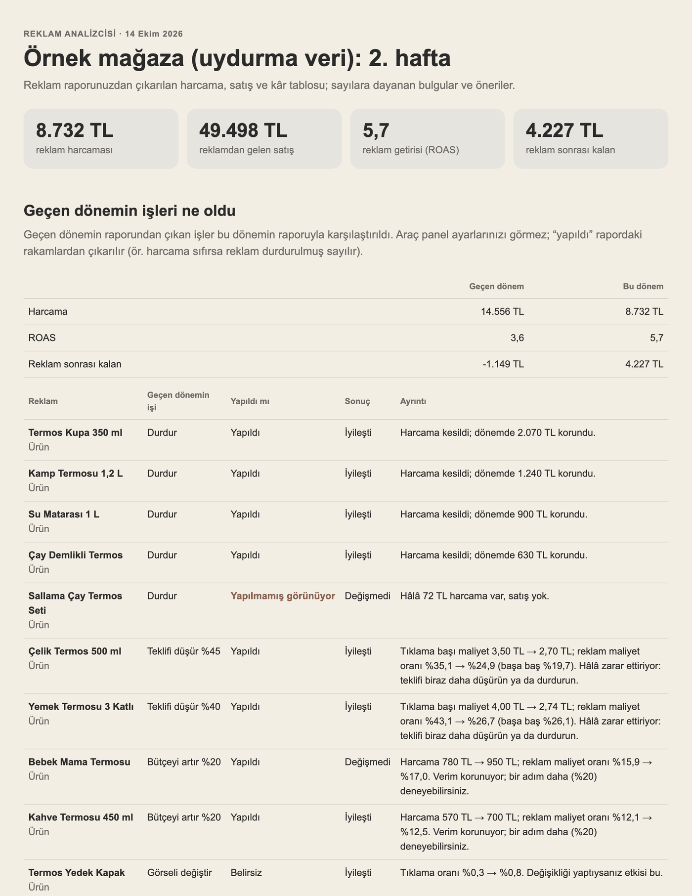

# Reklam Analizcisi

Reklamınız gerçekten kâr ettiriyor mu? Panel "reklam getirisi 3,6" der; ama ürün maliyeti, komisyon ve kargo
düşülünce reklam para kaybettiriyor olabilir. Bu araç panelden indirdiğiniz reklam raporunu okur, hangi reklamın
satış getirdiğini, hangisinin bütçeyi boşa harcadığını çıkarır ve maliyet bilgisi verirseniz **reklamdan sonra
elinize ne kaldığını** hesaplar. Ardından **her reklam için bu hafta panelde ne yapacağınızı** yazar ve bir hafta
sonra bunun işe yarayıp yaramadığını gösterir.



<sub>Rapor sayfasından "Yapılacaklar" bölümü. Rakamlar uydurma bir termos mağazasının örnek verisidir.</sub>

| Soru | Rapor ne gösterir |
|---|---|
| **Bütçem nereye gidiyor?** | Ürün (ya da kampanya) bazında harcama, reklamdan gelen satış, sipariş, tıklama |
| **Reklam kâr ettiriyor mu?** | Ürün başına reklam sonrası kalan ve başa baş oranı (maliyet bilgisiyle) |
| **Hangi reklam para yakıyor?** | Tıklanıp hiç satış getirmeyen ürünler ve arama terimleri, harcamalarıyla |
| **Sorun nerede?** | Görülüp tıklanmayanlar (görsel, başlık) ve tıklanıp satmayanlar (ürün sayfası, fiyat) |
| **Bu hafta ne yapmalıyım?** | Her reklam için panelde yapılacak tek iş, öncelik ve önerilen bütçe: durdur, teklifi %45 düşür, bütçeyi %20 artır, negatif kelime ekle |
| **Geçen hafta yaptıklarım işe yaradı mı?** | Geçen dönemin raporunu da verirseniz: hangi iş yapılmış, hangisi unutulmuş, sonuç iyileşti mi |

Sonucu **rapor sayfası** (tarayıcıda açılır, yazdırılır) ve **Excel dosyası** olarak verir. Excel'de sipariş başına
kâr hücreleri değiştirilebilir; sonuç yeniden hesaplanır. Ücretsiz, açık kaynak (MIT).

Araç reklam hesabınıza bağlanmaz, hiçbir şeyi değiştirmez; yalnızca indirdiğiniz dosyayı okur.

## Claude ya da ChatGPT sohbetinde kullanın

Tek tek yüklemek yerine serideki bütün araçları içeren [tek paketi](../README.md) kullanabilirsiniz.
Yalnızca bu aracı isterseniz: [reklam-analizcisi.zip](https://github.com/Harungokc/eticaret-agentlari/releases/latest/download/reklam-analizcisi.zip)

Satıcı panelinizin reklam bölümünden ürün bazında raporu Excel ya da CSV olarak indirin, mesaj kutusundaki **+**
düğmesiyle sohbete ekleyin ve yazın:

> Bu reklam raporunu analiz et: hangi reklam kâr ettiriyor, hangisi para yakıyor, ne yapmalıyım?
> Ürün maliyetlerim, komisyon oranım ve kargo ücretim şunlar: …

Bir hafta sonra yeni raporu geçen haftanınkiyle birlikte ekleyin:

> Bu haftanın ve geçen haftanın reklam raporları ekte, ikisi de 7 günlük. Geçen hafta yaptıklarım işe yaradı mı,
> bu hafta ne yapmalıyım?

Maliyetleri vermezseniz araç harcama ve satışı analiz eder ama kârı hesaplamaz. Yalnızca genel kâr payınızı
biliyorsanız ("satış fiyatının yaklaşık %25'i") onu yazmanız da yeter.

## Reklamları yönetmek: her hafta bir döngü

1. Raporu indirin, araca verin. **Yapılacaklar** listesi çıkar: her reklam için tek iş, önceliği ("Hemen", "Bu hafta",
   "İzle"), dönem harcaması ve önerilen harcama. Raporun kaç günlük olduğunu söylerseniz günlük bütçeyi de yazar.
2. İşleri panelde kendiniz yapın. Excel'deki "Yapıldı mı?" sütununa not düşebilirsiniz.
3. Bir hafta sonra yeni raporu, geçen haftanınkiyle birlikte verin. Araç geçen haftanın işlerini rakamlardan
   kontrol eder: harcaması sıfırlanan reklam durdurulmuş, tıklama başı maliyeti düşen reklamın teklifi düşürülmüş
   sayılır. Unutulan işi "Yapılmamış görünüyor" diye, kötüleşen sonucu "geri alın" diye gösterir.



<sub>Rapor sayfasından "Geçen dönemin işleri ne oldu" bölümü (uydurma örnek veri).</sub>

Örnek (uydurma veri): ilk hafta reklamlar 1.149 TL zarar ettiriyor. İşler yapıldıktan sonraki hafta
(`ornek/ornek_urun_reklami_sonraki_donem.csv`) 4.227 TL kalıyor. Araç unutulan bir "durdur" işini ve teklifi düşürülmüş
ama hâlâ zarar ettiren bir ürünü ayrıca gösteriyor.

| Durum | İş |
|---|---|
| En az 20 tıklama, satış yok · ya da ürün reklamsız da zarar ediyor | **Durdur** |
| Reklam zarar ettiriyor | **Teklifi düşür**: reklam maliyet oranını başa baş noktasına indirecek kadar (5'in katı); yarıdan fazla düşüş gerekiyorsa **durdur** |
| Rahat kâr ettiriyor (en az 5 sipariş, oran başa başın %60'ının altında) | **Bütçeyi %20 artır** |
| Az veri (3 siparişten az) | **Dokunma**, bir dönem bekle |
| Arama terimi: satış yok / çok pahalı / çok verimli | **Negatif kelime ekle** / **teklifi düşür** / **ayrı kampanyaya al** |

Maliyet bilgisi verilmezse kâr bilinmediği için "artır" önerisi temkinlidir ve genel orana göre verilir.

## Hangi raporlar

Araç sütun adlarını tanır: Türkçe ve İngilizce, "Harcama (TL)", "Satış Tutarı", "7 Günlük Toplam Satış (₺)",
"Spend", "Clicks" gibi. Başta açıklama satırları ya da altta toplam satırı olsa da okur. .csv ve .xlsx kabul eder.

**Önemli:** araç henüz hiçbir pazaryerinin gerçek reklam raporuyla denenmedi. Trendyol ve Hepsiburada'nın rapor
sütunları açık kaynaklarda yayımlanmıyor; Amazon, Meta ve Google için bilinen sütun adları eklendi ama gerçek
dosyayla doğrulanmadı. Araç bir sütunu tanımazsa dosyadaki sütunları listeler ve asistan eşleştirmeyi `--sutun`
ile verir (aşağıda); yani tanımadığı rapor da analiz edilir. Tanımadığı bir rapor gördüyseniz yalnızca başlık
satırını paylaşmanız aracın o raporu doğrudan tanımasını sağlar.

Arama terimi sütunu olan raporlarda (ör. Amazon arama terimi raporu) terim bazında bulgular da çıkar.

## Örnek sonuç

Uydurma bir termos mağazasının 12 ürünlük reklam raporuyla (`ornek/ornek_urun_reklami.csv`) ve maliyetleriyle
(`ornek/ornek_maliyetler.csv`):

```
REKLAM ANALİZİ — 12 satır, 12 ürün
  Harcama 14.556,00 TL · reklamdan gelen satış 52.177,30 TL · ROAS 3,58 · reklam maliyet oranı %27,9
  Satış getirmeyen harcama: 1.936,00 TL
  Reklam sonrası kalan (maliyeti bilinen kalemler): -1.149,16 TL

BULGULAR VE ÖNERİLER (5)
  1. [Bütçe] Satış getirmeyen reklam harcaması: 1.936 TL (%13,3)
  2. [Zarar] Reklamı zarar ettiren 4 ürün: toplam 3.700 TL
  3. [Büyüt] Reklamı rahat kâr ettiren 2 ürün
  4. [Görsel] Görülüyor ama tıklanmıyor: 3 ürün
  5. [Sayfa] Tıklanıyor ama az satıyor: 2 ürün
```

Panel 3,6 kat getiri gösteriyor; maliyet, komisyon ve kargo düşülünce reklamlar toplamda 1.149 TL kaybettiriyor.
Her bulgu hangi ürünlere ve hangi sayılara dayandığını ve önerisini de yazar.

## Hesaplar ve kurallar

- **ROAS** = reklamdan gelen satış ÷ harcama. **Reklam maliyet oranı** (ACOS) = harcama ÷ satış.
- **Sipariş başına kâr** (reklam öncesi) = satış fiyatı − ürün maliyeti − komisyon − kargo.
- **Başa baş oranı** = sipariş başına kâr ÷ satış fiyatı. Reklam maliyet oranı bunu aşarsa reklam zarar ettirir.
- **Reklam sonrası kalan** = sipariş × sipariş başına kâr − harcama.

Öneriler yapay zekâ tahmini değildir; rapordaki sayılara uygulanan sabit kurallardan çıkar:

| Bulgu | Kural |
|---|---|
| Satış getirmeyen harcama | En az 20 tıklama, sıfır satış |
| Bütçe yoğunlaşması | İlk üç kalem harcamanın en az %50'si ve harcama payı satış payını 15 puan aşıyor |
| Zarar ettiren reklam | En az 3 sipariş, reklam sonrası kalan eksi |
| Rahat kâr ettiren reklam | En az 5 sipariş, reklam maliyet oranı başa baş oranının %60'ının altında |
| Satışı en pahalı (maliyet yoksa) | En az 3 sipariş, reklam maliyet oranı genelin iki katı |
| Görülüyor ama tıklanmıyor | En az 1.000 gösterim, tıklama oranı genelin yarısı ya da altı |
| Tıklanıyor ama az satıyor | En az 20 tıklama, dönüşüm genelin yarısı ya da altı |
| Arama terimleri | Satış getirmeyen (20+ tıklama), pahalı (oran genelin iki katı), verimli (oran genelin yarısı, 3+ sipariş) |

## Komut satırı

```bash
python3 agent.py sutunlar reklam_raporu.xlsx            # sütunlar ve eşleştirme
python3 agent.py analiz reklam_raporu.xlsx --maliyet maliyetler.csv --rapor rapor.html --excel sonuc.xlsx
python3 agent.py analiz reklam_raporu.csv --kar-marji 25
python3 agent.py analiz bu_hafta.csv --onceki gecen_hafta.csv --maliyet maliyetler.csv --gun 7
python3 agent.py analiz reklam_raporu.csv --sutun harcama="Harcanan Tutar" --sutun ciro="Reklam Satışı"
python3 -m unittest                                      # testler
```

Maliyet dosyası: `Ürün;Birim maliyet;Komisyon (%);Kargo;Satış fiyatı` (boş şablon: `ornek/sablon_maliyet.csv`).

## Sınırlar

- **Reklam satışı, reklamın gerçek etkisi değildir.** Panel, reklama tıklayıp alan kişinin satışını reklama yazar;
  o kişi reklam olmasa da alacak olabilir. Özellikle mağazanızın ya da markanızın adıyla yapılan aramalarda reklam
  getirisi olduğundan yüksek görünür. Gerçek etkiyi yalnızca deneme (reklamı bir süre kapatıp karşılaştırmak)
  gösterir.
- Araç panel ayarlarınızı görmez. "Yapıldı mı" rakamlardan çıkarılan bir tahmindir; iki rapor aynı uzunlukta dönemi
  kapsamalıdır. Teklif düşünce satış adedi de düşebilir; önerilen harcama yaklaşık bir değerdir.
- Kâr, verdiğiniz maliyet bilgisi kadar doğrudur. İade, hizmet bedeli ve stopaj hesaba katılmaz.
- Atıf süresi (reklama tıkladıktan kaç gün sonraki satışın sayıldığı) platformdan platforma değişir; farklı
  platformların raporları birbiriyle doğrudan karşılaştırılmamalıdır.
- Araç herhangi bir pazaryeriyle ya da reklam hesabıyla bağlantılı değildir; sonuçlar bilgi amaçlıdır.
